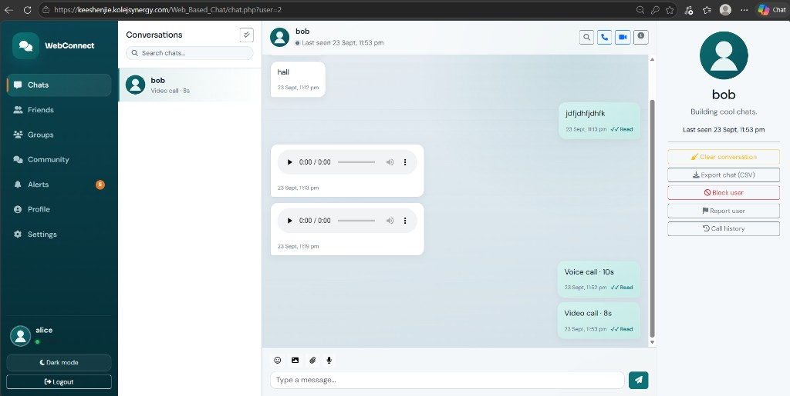

# WebConnect — Web-Based Chat, Voice & Video Communication System

A full-stack PHP/MySQL communication platform with private and group chat, media sharing, voice messages, WebRTC voice/video calls, friends, forums, notifications, and an admin panel.

Built for **XAMPP / Apache / MySQL / PHP 8.3+** and deployable on **cPanel**.



## Requirements

- XAMPP (or Apache + MySQL/MariaDB + PHP 8.3+)
- PHP extensions: `pdo_mysql`, `fileinfo`, `json`, `mbstring`, `openssl`
- Modern browser with WebRTC and MediaRecorder support (Chrome, Edge, Firefox, Safari)
- HTTPS required for camera/microphone on non-localhost deployments

## Technology

- PHP 8.3+ (PDO)
- MySQL / MariaDB (`utf8mb4`)
- HTML5, CSS3, Vanilla JavaScript
- Bootstrap 5, Font Awesome
- Fetch API polling (no Node.js / Socket.IO)
- WebRTC + MediaRecorder

## Installation (XAMPP)

1. Copy this project into your web root, for example:
   - `C:\xampp\htdocs\web_chat`
2. Start **Apache** and **MySQL** in XAMPP.
3. Create/import the database:
   - Open phpMyAdmin → Import → select `database/database.sql`
   - Or from CLI:
     ```bash
     C:\xampp\mysql\bin\mysql.exe -u root < database\database.sql
     ```
4. Edit configuration in `includes/config.php`, or create `includes/config.local.php`:
   ```php
   <?php
   define('DB_HOST', '127.0.0.1');
   define('DB_NAME', 'webconnect');
   define('DB_USER', 'root');
   define('DB_PASS', '');
   define('APP_URL', 'http://localhost/web_chat');
   ```
5. Ensure `uploads/` and `logs/` are writable by Apache.
6. Open: `http://localhost/web_chat`

## DEMO ONLY credentials

| Role  | Username | Password         |
|-------|----------|------------------|
| Admin | `admin`  | `Admin@ChangeMe1` |
| User  | `alice`  | `Demo@12345`     |
| User  | `bob`    | `Demo@12345`     |
| User  | `carol`  | `Demo@12345`     |

Demo users are already friends with each other. **Change the admin password before any public deployment.**

Admin panel: `http://localhost/web_chat/admin/login.php`

## Features

- Registration / login with hashed passwords and sessions
- Profiles, avatars, status messages
- Friend requests, friendships, blocking
- Private chat: text, images, files, voice, replies, reactions, delete, read/delivery status, typing, presence
- Group chat with owner/admin/member roles
- Secure media delivery via `api/media.php` (auth + range requests)
- WebRTC voice & video calls with PHP signalling
- Notifications
- Community forums (categories, posts, comments, likes, shares, reports)
- Admin dashboard: users, forums, reports, stats
- CSRF protection, rate limiting, prepared statements, XSS escaping

## cPanel deployment

1. Create a MySQL database and user in cPanel.
2. Import `database/database.sql` (via phpMyAdmin).
3. Upload project files to `public_html` (or a subdirectory).
4. Create `includes/config.local.php` with production DB credentials and `APP_URL` (HTTPS).
5. Set `uploads/` and `logs/` to writable (typically `755` or `775`).
6. Force HTTPS in cPanel / `.htaccess`.
7. Test login, chat, uploads, and calls.

Optional `.htaccess` sketch for subdirectory installs:

```apache
# Ensure PHP can run; deny browsing of uploads (already denied via uploads/.htaccess)
Options -Indexes
```

## WebRTC notes

- Microphone and camera require user permission.
- **HTTPS is required** except on `localhost`.
- STUN servers help with NAT traversal (`stun.l.google.com` is configured by default).
- Some corporate/symmetric NATs need a **TURN** server. Add TURN in `includes/config.local.php`:

```php
<?php
define('TURN_SERVERS', [
    [
        'urls' => 'turn:your.turn.server:3478',
        'username' => 'user',
        'credential' => 'pass',
    ],
]);
```

If peers cannot connect, the UI shows:

> Unable to establish the call. Your network may require a TURN server.

The app does **not** fake a “Connected” state — it waits for the WebRTC `connectionState === 'connected'`.

## Project structure

```text
web_chat/
├── admin/           # Separate admin auth & panel
├── api/             # JSON APIs + media delivery
├── assets/          # CSS / JS / images
├── database/        # schema + demo seed
├── includes/        # config, auth, security, layout
├── uploads/         # private media (not directly browsable)
├── chat.php
├── friends.php
├── groups.php
├── forums.php
└── README.md
```

## Security highlights

- `password_hash` / `password_verify`
- PDO prepared statements
- CSRF tokens on state-changing requests
- Session regeneration on login
- Upload validation (extension + MIME + size) with randomized filenames
- Authorization checks for messages, groups, calls, and media
- Rate limits on login, messaging, friends, forums, and calls

## License

Provided as an educational / project codebase. Adapt freely for coursework or internal demos.
